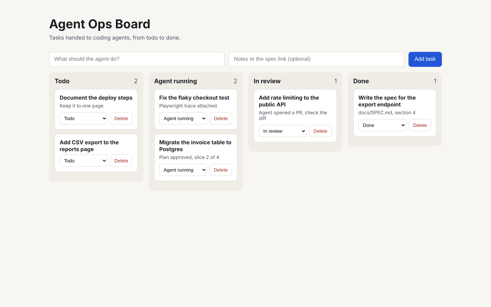

# Agent Ops Board

A small Next.js + TypeScript board for tracking tasks handed to coding agents (todo, agent running, in review, done). I built it to show how I work with Claude Code: a written spec, a plan I approve, small slices, tests first, a reviewed diff, a clean commit.



## Run it
```bash
npm install
npm run seed
npm run dev        # http://localhost:3000
npm test           # 8 unit tests
npm run typecheck
```
Needs Node 22.13 or newer (it uses the built-in `node:sqlite`).

## Stack
Next.js 16 (App Router), React 19, TypeScript strict, SQLite via `node:sqlite`, Vitest, Playwright for the browser check, GitHub Actions CI.

## Where the agent rules live
- `CLAUDE.md`: commands, workflow and code rules the agent reads every session
- `docs/SPEC.md`: what the app does, the API and the definition of done
- `.claude/skills/`: short skills for the API pattern and test-first work
- `docs/LOOM_TASK.md`: the live change I record (task priority with a filter)
- `docs/DEV_ENVIRONMENT.md`: my setup

## Author
Ismail Bentabett, full-stack developer. github.com/ismailbentabett
